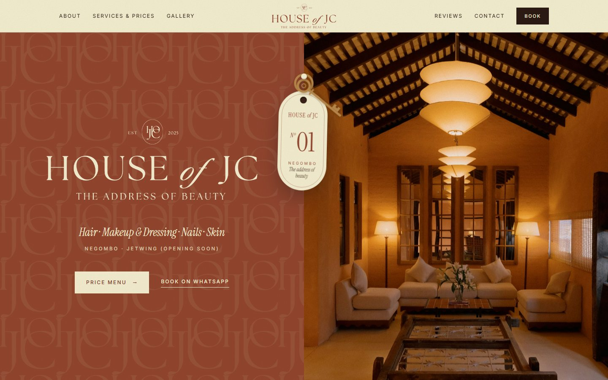
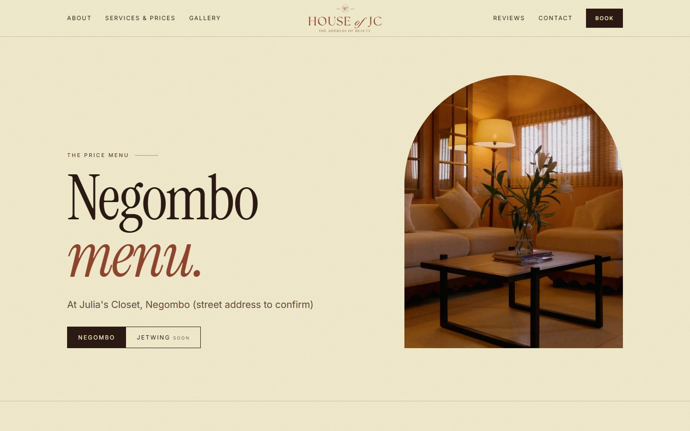
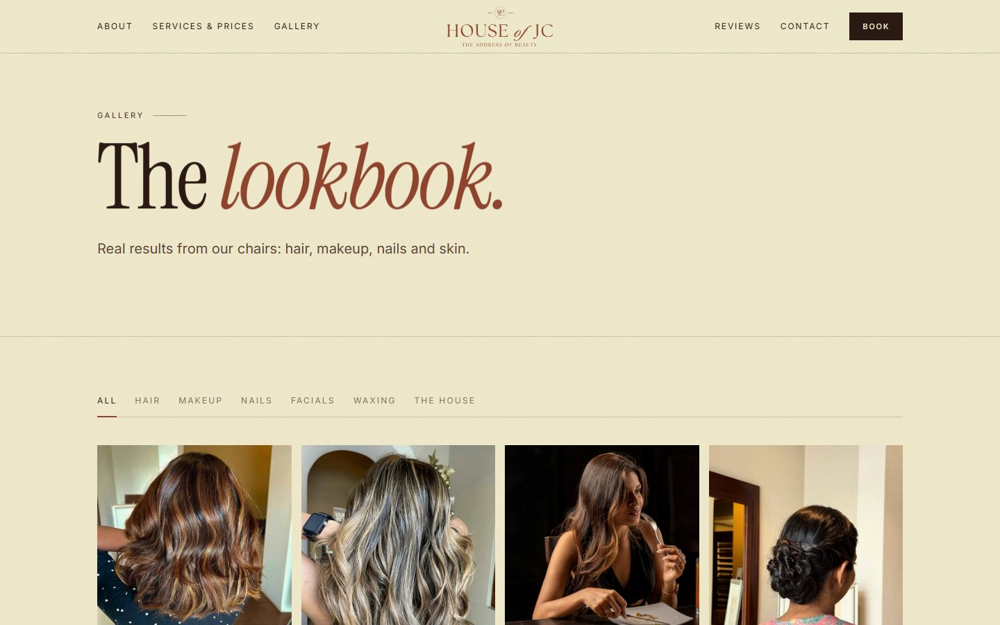
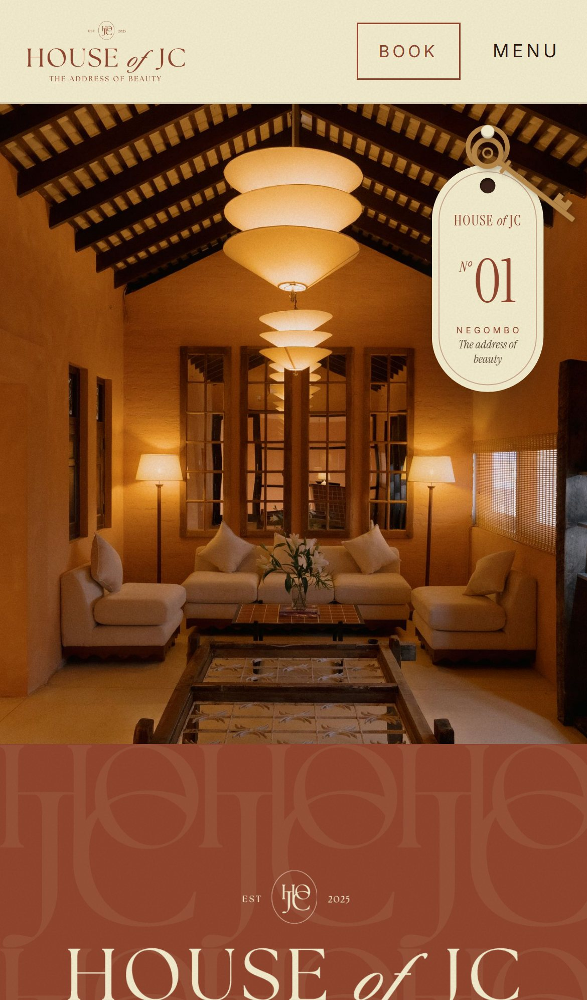

# House of JC

**Website and admin for a beauty salon brand in Sri Lanka**

Hair · makeup and dressing · nails · skin

**[Visit the live site](https://house-of-jc.vercel.app)**

> [!NOTE]
> This is a **showcase repository**: it presents the project, not its source code. The code is private.
> House of JC was designed and built by **Tehan Athaudage** ([Website by TA](https://websitebyta.vercel.app)).

| | |
|---|---|
| **Type** | Client website + CMS |
| **My role** | Design and development |
| **Built by** | Tehan Athaudage (Tehan Gimsara), Website by TA |
| **Live** | https://house-of-jc.vercel.app |

## About the project

House of JC, "The Address of Beauty", is a salon brand with a flagship in Negombo and a second salon on the way. The brief was a warm, heritage-inspired site that shows real prices per salon, and an admin simple enough for salon staff to update services, photos and reviews themselves.

## What I built

| | |
|---|---|
| **Price menu per salon** | Services and prices grouped by category, with a separate menu for each location. |
| **The lookbook** | A gallery filterable by hair, makeup, nails and facials; featured photos also appear on the home page. |
| **Booking on WhatsApp** | Every call to action opens WhatsApp with a ready-written appointment message. |
| **Salon admin** | A branded, task-first Payload CMS admin for services, locations, gallery, reviews and page content. |
| **Multi-location ready** | Locations can be marked open or coming soon, with hours, maps and contact details each. |
| **Integrations** | Instagram feed and Google reviews, switched on with API keys. |

## Screens

<table>
<tr>
<td width="50%"> <b>Negombo price menu</b></td>
<td width="50%"> <b>The lookbook</b></td>
</tr>
<tr>
<td width="50%"> <b>Home page on a phone</b></td>
</tr>
</table>

## Tech stack

Next.js · React · TypeScript · Payload CMS · SQLite (libSQL) · Vercel

## Want something like this?

I'm Tehan Athaudage, a freelance web designer and developer from Sri Lanka working with businesses worldwide.

[Portfolio](https://websitebyta.vercel.app) · [LinkedIn](https://www.linkedin.com/in/tehan-athaudage-663102382/) · [Instagram](https://www.instagram.com/websitebyta/) · [Facebook](https://www.facebook.com/Thalric1) · [Email](mailto:websitebyta@gmail.com) · [WhatsApp](https://wa.me/94761629355)

---

© 2026 Tehan Athaudage. Showcase only: see [NOTICE.md](NOTICE.md). Client names, logos and photos belong to their owners.
